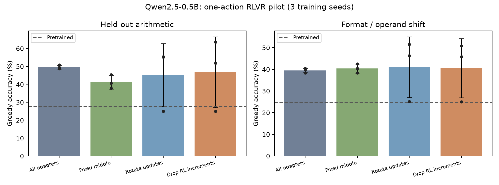
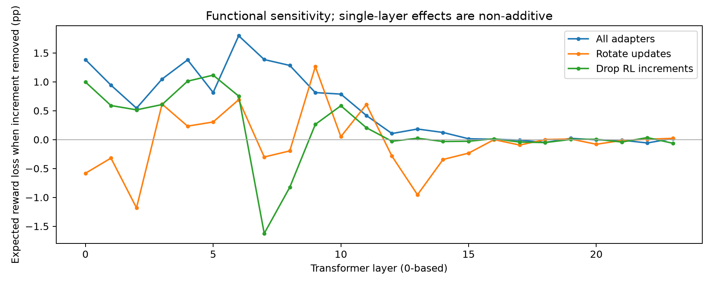

# RL Layer Dispersion Pilot

随机关闭已学习的 RL 增量，能否减轻对少数 Transformer 层的依赖，并改善泛化？

**当前结果：没有观察到稳定提升。** 这是一次小规模、三种子的初筛实验，公开代码、合成数据、原始预测与失败结果，便于保存、复核和后续研究。实验于 2026-10-24 完成，2026-10-26 首次公开。

## 结果

| 方法 | 同分布准确率 | 域外准确率 |
| --- | ---: | ---: |
| 全部层 LoRA（All） | 49.65% ± 1.05 | 39.50% ± 1.08 |
| 固定中间 6 层（Middle） | 41.23% ± 3.81 | 40.36% ± 2.08 |
| 每步轮流冻结 6 层更新（Rotate） | 45.23% ± 17.52 | 41.02% ± 14.00 |
| 每步随机关闭 6 层增量（Delta-drop） | 46.79% ± 19.76 | 40.54% ± 13.68 |

± 是三个训练种子的样本标准差；域外分数是表述变化与更大操作数两项测试的等权平均。Delta-drop 相对 All 的域外差值为 **+1.04 个百分点**，探索性配对 bootstrap 95% 区间为 **[-14.58, +11.59] 个百分点**。Delta-drop 的三个种子中有一个退化至 25% 准确率，不能只选表现最好的种子报告。



完整中文报告见 [RESULTS.txt](RESULTS.txt)，结构化汇总见 [runs/summary.json](runs/summary.json)。

## 实验设定与边界

- 模型：Qwen2.5-0.5B-Instruct，24 层；冻结预训练权重，每层七个投影使用 rank-8、alpha-16 的自定义 LoRA。
- 任务：加减乘四选一，只允许 A/B/C/D 四个单 token 动作。按四个动作重新归一化概率；这是 contextual-bandit RL，并非开放词表生成或长链推理 GRPO 的复现。
- 优化：每步 16 题，每题采样 8 次，组内标准化优势，单次 on-policy 更新，加相对预训练四动作策略的精确 KL 惩罚（系数 0.1）。三个主实验种子为 11、22、33，每次 300 步。
- 调参：每种方法分别在独立种子 0 上，以 200 步比较 3e-5 与 1e-4 两个学习率，仅按验证集期望奖励选择；主实验固定使用末尾 checkpoint。
- 数据：训练 1536、验证 192、同分布测试 384、格式变化 384、大操作数 384 题。四道不同题共享相同有序选项且正确字母各出现一次；任何忽略问题、只看选项的策略在完整四题组上准确率恰为 25%。跨划分去除相同算式及交换律重复。
- Delta-drop 每步整批共享同一个层 mask，关闭 24 层中随机 6 层的 LoRA 增量，保留全部预训练计算；采样与损失使用同一个 mask。主实验不做反向存活率缩放，推理时所有增量开启。Rotate 保留所有增量的前向计算，仅冻结选中层的参数更新。Middle 使用从 0 起计的第 9–14 层。
- 后续补充诊断仅在调参种子 0 的验证集上，在推理增量缩放 1 与 0.75 之间选择一个值，再统一用于三个主种子。它未消除退化种子；主表保留原协议结果。

我们尚未建立原论文的单层训练效果曲线。单层增量撤除敏感性是非加性的功能依赖指标，不能当作各层 RL 收益的可加分解，也不能从性能变化直接推断学习已变得更分散。该实验不证明或否定更大模型、全参数 RL 或长链推理上的假说。



## 保存的内容

- `rl_layer_pilot.py`：数据生成、模型、四组处理与训练。
- `protocol.json`：本次实验协议与初筛标准；`main-protocol-sha256.txt` 保存主协议及训练代码哈希。
- `data/arithmetic.json`：完整合成数据；`runs/*/seed_*/`：12 次主实验的数值、原始预测；`runs/tune/`：8 次调参结果。
- `audit_data.py`、`verify_mechanism.py`、`verify_results.py`：数据、mask/梯度、checkpoint 重载复核。
- `diagnose_drop_scale.py`、`analyze_pilot.py`：补充诊断、汇总、探索性区间与图表。
- [Release v0.1-pilot](https://github.com/siddhartha-yz/rl-layer-dispersion-pilot/releases/tag/v0.1-pilot)：20 个主实验与调参 LoRA checkpoint 的归档。`checkpoints-sha256.txt` 记录各文件哈希。基础模型权重与第三方论文不在发布包中。

早期被选项捷径污染的数据版本、无 KL 的不稳定试跑和 probe 均不混入主结果。它们未打包进此次公开快照。详情及分析变更见 [PUBLICATION_NOTES.md](PUBLICATION_NOTES.md)。

## 复核与重跑

原环境为 Python 3.12.14、PyTorch 2.14.0+cu130、Transformers 4.57.6，GPU 为 RTX 5070 Ti Laptop（约 12GB 显存）。需要支持 BF16 的 NVIDIA CUDA 环境。精确依赖记录见 `requirements-environment.txt`；该文件不含通过本机已有环境复用的 PyTorch，因此必须单独安装 torch。

```bash
git clone https://github.com/siddhartha-yz/rl-layer-dispersion-pilot.git
cd rl-layer-dispersion-pilot
python3.12 -m venv .venv
.venv/bin/python -m pip install --upgrade pip
# 按本机 CUDA/驱动情况安装匹配的 PyTorch；原环境使用 cu130：
.venv/bin/python -m pip install torch==2.14.0 --index-url https://download.pytorch.org/whl/cu130
.venv/bin/python -m pip install -r requirements.txt
```

只检查已公开文件完整性，无需 GPU 或下载模型：

```bash
sha256sum -c publication-sha256.txt
```

不重新训练，恢复 checkpoint 并复核已有实验（需要约 1GB 基础模型下载）：

```bash
curl -fL https://github.com/siddhartha-yz/rl-layer-dispersion-pilot/releases/download/v0.1-pilot/checkpoints.tar.gz -o checkpoints.tar.gz
tar -xzf checkpoints.tar.gz
rm checkpoints.tar.gz
sha256sum -c checkpoints-sha256.txt
./reproduce.sh
```

从头重跑：

```bash
./reproduce.sh --rerun
```

`--rerun` 会将已有 `runs/` 移到本地 `archive/reproductions/`，重新调参和训练。默认运行跳过已有训练结果，但仍会重载 checkpoint、重新评分、执行补充诊断并生成报告。脚本通过固定 Hugging Face revision 下载基础模型并核验权重 SHA-256，网络代理使用常规环境变量配置，无需本机特定代理端口。不同 GPU、CUDA 与库版本可能造成数值差异；随机种子不保证跨平台逐位一致。

## 灵感与近邻工作

研究灵感来自 [Is One Layer Enough?](https://arxiv.org/abs/2607.01232) 中部分单层 RL 训练可接近全参数训练的现象。它衡量的是“只训练某层的效果”，不等同于全参数训练中该层实际承担的收益比例。

[CoTo（ICML 2025）](https://proceedings.mlr.press/v267/zhuang25c.html) 已研究通过逐层随机关闭适配器、逐渐增加激活概率来促进更均衡的优化；[Loop Dropout（2026）](https://arxiv.org/abs/2609.34218) 在共享参数的循环语言模型上结合增量屏蔽与幅度补偿。随机关闭增量本身不作为本项目的原创声明。此次尚未实现 CoTo 的渐进调度对照；RL 特有机制与可靠收益仍需进一步实验。
